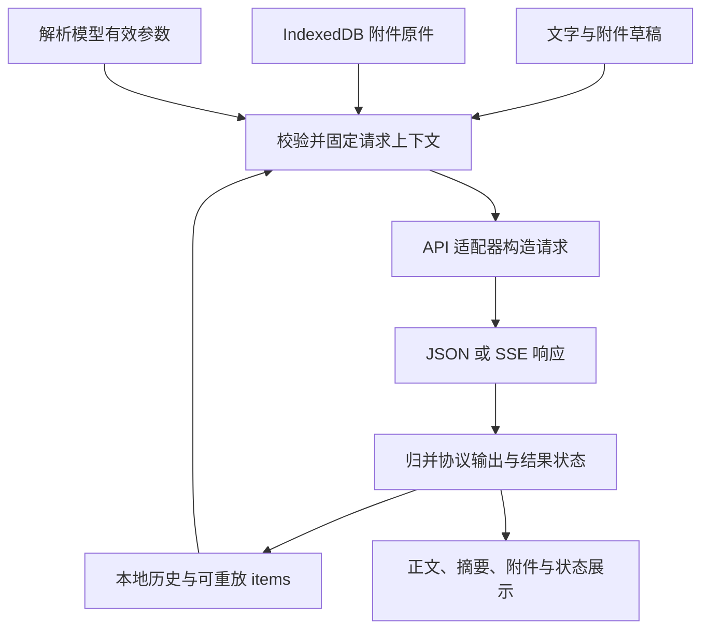

# Responses 协议完善与附件输入：设计及实施计划

日期：2026-10-24。基线提交：`6980418`。状态：开发实施完成，验证记录见文末。

本次先完成 Responses 的正确性、异常恢复和模型参数作用域，再增加图片、文件输入。维持原生 HTML/CSS/JavaScript、无构建依赖、配置同步和历史本地保存的现有架构。

“图片/文件的输入及接受”暂按用户可以选择、粘贴、拖入附件，模型可以接收并理解，历史可以恢复和重发来设计。模型生成图片、返回可下载文件属于另一套输出能力，待用户明确后另行定范围。本次不增加工具调用。

**1. 核心设计决定**

| 问题 | 设计决定 | 目的 |
| --- | --- | --- |
| Responses 输出被压成两个字符串 | 每条 assistant 消息保存协议输出项，正文与摘要由统一函数投影 | 保留 reasoning、phase、消息边界和拒绝语义 |
| 终态和快照处理不完整 | 一个按 item/part 归并的 reducer，同时服务流式和非流式响应 | 两种模式得到相同内容与结果状态 |
| 通用逻辑识别 `[DONE]`、`<think>` | 完成判定归适配器，标签解析是显式供应商兼容选项 | 避免跨协议误判和改写正文 |
| 参数全局串用 | 安全的全局默认值 → 供应商覆盖 → 模型覆盖 | 支持混用不同协议和模型 |
| 附件体积大 | Blob 放 IndexedDB，历史和草稿只保存引用 | 避免流式保存、三方合并、卸载暂存反复复制文件 |
| 发送过程中配置和页面可能变化 | 点击发送时创建固定请求上下文，准备附件也受取消控制 | 请求、返回结果和所属会话保持一致 |



**2. 消息、重放和来源边界**

保留现有 `message.content`、`message.reasoning`，让历史搜索、复制、Markdown 导出及现有界面继续工作。Responses 消息增加有版本号的协议记录；这两个展示字段只由统一投影函数更新，禁止多处分别拼接和修补。

示意结构，不作为最终字段命名约束：

```javascript
{
  id: 'local-message-id',
  role: 'assistant',
  content: 'Displayed answer',
  reasoning: 'Displayed summary',
  protocol: {
    version: 1,
    apiType: 'responses',
    source: {
      providerId: 'provider-id',
      baseUrl: 'https://api.openai.com/v1',
      modelId: 'model-id',
      instructions: 'Captured system instructions'
    },
    responseId: 'resp_...',
    status: 'completed',
    output: [/* 按 output_index 排序的协议输出项 */]
  },
  outcome: 'completed'
}
```

- 保留 reasoning item 的 `id`、`summary`、`encrypted_content` 及协议提供的相关内容；不把摘要当成可替代加密推理状态的文本。
- 保留每条 assistant message 的 content parts、`phase`、拒绝内容与 annotations。commentary 和 final answer 在存储及重放中保持边界；展示时也有明确分隔。
- 保存的协议快照与发出的输入不是同一个对象。重放函数按官方 input schema 构造新对象，剔除输出专用字段及本地元数据，不直接展开任意服务器 JSON。
- 输出消息自身也是 input union 成员；其 id/status 是协议字段，重放时保留。缺少这些字段的兼容响应使用带 phase 的文本消息表示。来源通过本地保存的完整 instructions 精确匹配。
- 本次支持的输出项为消息和推理。未知事件可以忽略；未知输出项保留供诊断并明确标记不支持。收到需要工具执行的输出不能显示成空白成功，也不自动执行工具。
- 原始 items 仅在来源匹配的连续历史区段内重放。供应商 ID、规范化 API 地址、模型和系统提示共同限定来源；API Key 不进入来源记录，轮换 Key 不使上下文失效。
- 模型、供应商或系统提示发生变化后，更早的不兼容区段使用可见历史表示，opaque reasoning 不跨来源重放。切回原模型也不跨越中间的不兼容区段复用旧推理。
- 旧消息没有 protocol 时走现有文本历史路径；不猜测已经丢失的 phase 或 reasoning。
- 已确认完成的响应可重放规范化 items。incomplete 仅复用已完成且满足输入约束的项；failed、stopped、unconfirmed 保留可见部分文本，不复用未确认的 opaque reasoning，不伪造 final phase。
- 编辑、重新生成、撤销均以消息为单位操作，协议记录随所属消息截断或恢复，避免出现独立的失效 response 链。

继续使用 `store: false` 和手动历史重放。本次不引入 `previous_response_id` 或服务端 Conversations。

**3. 流式归并、结束确认和失败恢复**

将 Responses 的事件归并放进一个无 DOM、无网络、无存储依赖的模块，便于直接测试。运行时按 `output_index` 管理 items，使用 `item_id` 校验归属，再按 `content_index`、`summary_index` 管理正文、拒绝及摘要 parts。

| 输入 | 归并行为 |
| --- | --- |
| `response.created`、`response.in_progress` | 记录响应 ID、模型、运行状态等元数据 |
| item/part added | 建立槽位并保留协议元数据，不重复追加初始文本 |
| 正文、拒绝、摘要 delta | 追加到对应 part；有 sequence_number 时防止同一事件重复应用 |
| 正文、拒绝、摘要 done | 以快照替换对应 part，禁止再次 append |
| content/summary part done | 校正完整 part，恢复 delta 中未能解析的内容 |
| output item done | 校正完整 item，记录其完成程度及可用的 encrypted_content |
| completed / incomplete | 校验终态对象及事件状态一致性，以完整 response.output 对齐最终结果 |
| failed / error | 先合并可用输出、usage 和元数据，再记录结构化错误 |
| EOF、取消、超时 | 保留已接收内容，分别标记 unconfirmed、stopped、failed |

实现要点：

- 非流式 JSON 与流式终态调用同一套 response 归并和投影函数。
- 终态快照可以清空先前临时内容；不能只在非空时覆盖，否则会遗留错误的 delta 内容。
- output item done 只证明该输出项结束，不能据此把整个响应标成 completed。
- Responses 的成功确认来自合法 `response.completed`。`response.incomplete` 是已结束但未完整完成；`response.failed` 是失败。
- SSE framing 层只负责拆帧、UTF-8、event/data 字段及 JSON 解析，完成判定交给适配器。Chat 保持其 finish_reason、usage、`[DONE]` 行为。
- Responses 遇到第三方 `[DONE]` 可以结束读取，但在没有合法终态时标为 unconfirmed。缺失 response 的 completed 事件不能被接受为成功。
- 非流式返回 queued/in_progress 时，本次不启动后台轮询，显示不支持的响应状态；不能当作完整答案。
- malformed JSON 留下诊断信息，后续合法 done/终态快照仍可恢复。没有权威终态时保持未确认状态。未知合法事件不等于协议错误。
- 不强制 sequence_number 连续，兼容没有序号的实现；不增加自动重连或自动重发。
- 保留错误 `code`、`param`、请求 ID、HTTP status 和服务端消息，统一脱敏及长度限制。错误提示优先使用结构化信息，避免只依赖英文消息关键词。
- 没有可显示文本时给出明确状态，区分空输出、拒绝、仅推理、未知输出类型和失败。

持久化结果使用一个明确的 outcome：`completed / incomplete / failed / stopped / unconfirmed`。流结束、内容项结束与响应成功分别表达；现有 notice、导出与辅助阅读提示统一读取该结果，迁移期间兼容旧标记。

**4. `<think>` 兼容逻辑**

供应商增加“将正文中的 `<think>` 解析为思考”选项，内部可用 `reasoningFormat: 'structured' | 'think-tags'` 表示。

- 新供应商默认 structured；新建官方 Responses 配置始终默认 structured。
- 旧 Chat 供应商迁移为 think-tags，保留已有兼容行为；旧 Responses 默认 structured，用户可为特殊兼容服务显式开启标签解析。
- 模式在请求开始时固定，并随消息记录；以后修改设置不重新解释已经保存的正文。
- 标签解析只作用于兼容模式的展示投影及其文本历史策略，不覆盖原始 Responses items。
- structured 模式中的 `<think>` 是字面正文，保存、复制和重放保持原文。渲染层对相应非代码 HTML token 做安全的字面展示，避免 sanitizer 将其连同内部文字隐藏；不对全文做会破坏代码块的替换。
- 已经由旧版本提取并丢失标签的历史不做逆向恢复。

**5. 参数作用域、校验和迁移**

采用全局默认、供应商覆盖、模型覆盖三层。覆盖保存在现有 provider/model 对象内，避免另建容易失配的模型键索引。解析和校验由侧栏与设置页共用的轻量模块负责。

| 配置值 | 含义 |
| --- | --- |
| 覆盖项中缺少字段 | 继承上一级 |
| `null` | 显式采用模型默认，请求不发送该字段 |
| 合法具体值 | 覆盖上一级并发送 |
| reasoning effort 的 `'none'` | 显式关闭推理，不等于省略 |

上述 null 语义适用于可省略的模型参数；stream 只有继承或 true/false，不提供无效的 null 状态。

- 新配置的 temperature、输出上限和 reasoning 选项默认不发送；stream 默认 true。
- 推理强度包含 `none / minimal / low / medium / high / xhigh / max`。摘要保留 auto/concise/detailed，并以“不发送”表示关闭请求选项。
- 增加可选 `reasoning.context`；模型默认优先，提供 auto/current_turn/all_turns。`reasoning.mode` 本轮暂不增加，避免把另一项高级能力混入必要修复。
- 模型支持范围不同；不把 `/models` 列表视为能力探测结果。确定的协议限制做本地校验，未知供应商保留可配置性，返回不兼容错误时指出字段和有效来源。
- 不根据模糊模型名前缀自动删改用户显式参数，不在 400 后静默更换配置重发。
- 设置页用一个作用域选择器切换“默认 / 供应商 / 模型”，覆盖控件提供“继承 / 模型默认 / 自定义”。显示有效值来自哪里，并提供清除本层覆盖操作。
- `<think>` 兼容属于供应商行为；stream、temperature、token 上限及 reasoning 属于生成参数，不混入外观或会话字段。

迁移采用配置版本号和幂等纯函数：旧全局生成值移入升级时已经存在的供应商覆盖，新的全局默认采用安全默认。这样保存旧行为，同时后续新建供应商不会继承遗留参数。旧 `max_completion_tokens` 转换为内部统一的输出上限，由适配器映射请求字段；off/空字符串转换成明确的省略值。

旧 temperature=0.7 无法证明是用户主动配置还是历史默认，因此保留，不擅自清空。设置界面说明它来自迁移值，并允许一键恢复模型默认。迁移先在内存完成，确认持久化成功后再记录版本；同步失败可以重试。

覆盖仍受现有 sync 单项 8 KB 约束，只保存实际差异。配置写入增加同源 Web Lock，并在锁内读最新配置、应用按 provider/model ID 定位的修改，保留其他页面未被本次编辑的字段。模型重命名保留覆盖，删除模型移除其覆盖；配置导入、导出覆盖新 schema。

**6. 图片与文件输入范围**

用户动作：文件选择、图片粘贴、文件拖放；可以只发送附件，也可以附带文字。普通 URL 粘贴继续作为文字，不自动访问网页或下载远程文件。

| 类别 | 本次范围 | Responses | Chat Completions |
| --- | --- | --- | --- |
| 静态图片 | PNG、JPEG、WEBP、通过静态检查的 GIF | `input_image` | `image_url` |
| PDF | `.pdf` | `input_file` | `file` |
| 文本与代码 | 官方接受列表内的常用格式 | `input_file` | 明确提示改用 Responses |
| 文档、演示、表格 | DOC/DOCX、RTF/ODT、PPT/PPTX、CSV/TSV、XLS/XLSX | `input_file` | 明确提示改用 Responses |

使用原件直传，图片编码为 data URL，文件编码为含 filename 的 file_data。发送之前仅在本地保存，不预先上传。首版不增加 Files API 上传及其远程文件生命周期；不自行解析 Office、PDF，也不加入解析依赖。

非 PDF 文档的嵌入图片不保证进入模型上下文；带图表的文档可提示用户转成 PDF。PDF 的视觉理解、图片理解都要求模型具有相应能力；错误提示应明确区分协议不支持、模型不支持和文件内容无效。

建议的初始产品限制：每条最多 10 个附件、单个原件不超过 10 MiB、单次请求包含的全部历史附件原件合计不超过 20 MiB，编码后请求体不超过 30 MiB。这些是侧栏内存和重发成本的产品限制，不冒充官方限额。编码前估算 Base64 和文字开销，序列化后再核对实际大小，避免先分配超大请求再发现超限。文件类型按明确的扩展名/MIME 映射检查，浏览器返回空 MIME 时从受支持的扩展名补全；图片校验实际签名。拒绝明显不匹配、动画 GIF、SVG、压缩包和未支持格式。

请求前检查完整历史中的附件，不能只检查本条草稿。超限时保留草稿并指出处理方式；不静默删除旧附件、截断文档、压缩图片或只发送第一页。模型或协议切换后重新校验；不支持的历史附件不能悄悄变成文件名文本。

**7. 附件存储、草稿、重试和界面**

附件原件放扩展同源 IndexedDB，以随机 ID 索引 Blob、MIME、大小和创建时间。`chrome.storage.local` 中的消息只保存 ID、名称、类型和大小等引用；不保存 Base64、临时 object URL 或 File 对象。文件名是文字，不作为 HTML 或存储路径使用。

草稿从字符串升级为 `{ text, attachments }`，通过统一 normalize 函数接受旧字符串。需要同时调整恢复、空会话判断、选中文本导入、清空、跨页比较和卸载暂存。现有 `savedDrafts` 的浅比较必须改为结构比较及独立快照，避免修改附件数组后漏存。

附件发布采用“原件先持久化，再发布引用”的顺序。IndexedDB 与 chrome.storage 之间没有跨库事务，不能宣称原子提交：先写成功但引用保存失败时允许留下可回收孤儿；引用保存失败则保留当前页附件与保存错误，允许重试，不能清空草稿或显示已可靠保存。

正常流式保存、跨页同步、历史列表与搜索都只处理元数据。只有预览、下载和请求构建读取原件；请求编码限制并发，结束后释放临时 Base64 和 object URL。图片原件与缩略预览分开，历史仅加载可见消息的预览。

删除、编辑、重新生成保留现有撤销语义。附件不即时物理删除；采用标记回收和至少 24 小时宽限期。回收在存储锁内读取并折叠 pending 保存，检查所有消息、草稿、暂存及有效的附件持有记录；活跃发布和撤销持有的附件不得删除。新引用清除回收标记。保存失败或扫描不完整时停止回收，优先保留原件。该机制只负责无引用原件，不扫描或读取全部 Blob 内容。

附件持有记录只用于准备/发布和撤销窗口，以页面 ID、附件 ID、用途和到期时间表达；发布完成或撤销结束后释放。回收宽限期从确认无引用时开始计算，不能按文件创建时间直接删除。附件发布、引用变更和回收使用同一个本地存储锁，避免并发回收刚准备发布的原件；实现时避免在已有锁内再次排队申请同名锁。

具体交互：

- 输入区增加附件按钮、附件条、图片缩略图或文件卡片、大小、移除和读取/保存错误。接收附件的目标会话在动作开始时固定。
- 文件未准备完成时不能发送；准备过程允许取消。纯附件消息可发送，空会话标题可由文件名产生。
- 发送前固定 provider、model、instructions、有效参数、历史和附件引用；异步读取时不能使用随时变化的全局选择。
- 附件预检、编码也纳入 generation 生命周期，防止重复点击、停止后仍发送、切换会话后写错聊天。
- 网络请求超时从附件准备结束后开始计时；本地读取/保存错误与服务端 API 错误分别反馈。取消准备应保留可继续编辑的草稿。
- 附件缺失时显示具体文件名，提供重新选择原件或编辑移除；不通过空 content 静默继续请求。
- 用户消息显示已发送附件，支持查看图片和下载原件。文件作为下载处理，不在扩展页执行 HTML 或加载主动内容。
- 编辑用户消息时允许保留、移除或替换附件；只有文字或附件真正变化才重新生成。撤销恢复完整消息及其引用。
- 请求失败或停止后，附件跟随已保存的用户消息，重试使用同一原件。新的输入草稿独立保存。
- Markdown 导出列出附件名称、类型和大小，不嵌入 Base64 或失效 blob URL；原件可单独下载。现有 Markdown 导出不承诺成为可恢复附件的会话备份，本次不新增归档格式。
- 发送前说明附件会随对话提交给所选供应商，续聊可能再次发送历史附件；在产品界面使用用户能理解的表达。

**8. 文件组织与改动边界**

| 文件 | 预计改动 |
| --- | --- |
| `sidebar/responses.js`（新增） | 纯协议归并、快照、投影与输入规范化，避免 sidebar.js 继续膨胀 |
| `sidebar/attachments.js`（新增） | Blob 存取、文件校验、编码、预览 URL 生命周期与引用回收 |
| `assets/js/generation-settings.js`（新增） | 两个页面共用的参数 schema、作用域解析、迁移和校验 |
| `sidebar/sidebar.js` | 适配器接线、固定请求上下文、结果状态、草稿及附件界面整合 |
| `sidebar/sidebar.html`、`sidebar/sidebar.css` | 脚本顺序、附件输入与编辑界面，复用主题变量 |
| `options/options.js`、`options/options.html`、必要的 CSS | 参数作用域、继承/省略语义、兼容开关和导入导出 |
| `assets/js/ui.js` | 必要的共享配置写锁与小型 UI 工具，避免混入协议实现 |
| `tests/` | 聚焦契约的 Node 测试、少量真实浏览器附件与迁移测试 |
| `README.md`、`AGENTS.md` | 支持范围、架构约定、文件限制、验证方式 |

使用普通 script 按依赖顺序加载，以命名空间封装新增模块，不引入模块打包、框架或运行时依赖。请求构造允许异步，适配器继续独占协议差异。后台 service worker 原则上无需修改。

**9. 分阶段实施与退出条件**

| 阶段 | 实施内容 | 完成条件 |
| --- | --- | --- |
| A：协议数据模型 | protocol 记录、来源边界、规范化重放、旧历史兼容、编辑撤销关联 | 第二轮请求保留可用 reasoning/phase；跨来源不泄漏 opaque items |
| B：正确性及恢复 | 共用 reducer、done 快照、权威终态、失败结果、错误信息、think 模式隔离 | JSON/SSE 结果一致；断流不假成功；正文不被误改；异常保留最大可用结果 |
| C：模型参数 | 作用域解析、完整 effort 枚举、context、幂等迁移、设置和配置并发保存 | 模型切换不串用覆盖；继承、null、none 语义清楚；旧配置可正常升级 |
| D：附件底层及请求 | Blob 存储、草稿引用、校验、完整历史预检、异步适配器和准备取消 | 原件重启后可取回；请求协议正确；失败不生成悬空成功状态 |
| E：附件用户流程 | 选择/粘贴/拖放、附件消息、编辑重试撤销、下载、导出元数据 | 完成一次附件对话后，重载、续聊、编辑和重试均可使用正确原件 |
| F：整体验收 | 精简测试整理、旧功能回归、文档、构建包内容验证 | 必要检查全部通过，记录真实浏览器与模拟协议验证的边界 |

A/B 连续实施，因为终态、快照、重放必须共用同一份状态。C 完成后再进入附件阶段；D 的持久化与协议通过后才接上 E，避免只有界面能选文件而历史无法可靠恢复。

**10. 回归测试策略**

按行为契约组织测试。每个新增用例应能指出它阻止的具体回归；使用固定的小型官方形状 fixture、可控计时器和可控流。避免为每个字段 getter、DOM 类名或全部模型组合单独加测试。

| 契约 | 重点断言 | 合适层级 |
| --- | --- | --- |
| 协议重放完整且来源受控 | 第二轮实际请求保留 reasoning、phase、拒绝和消息顺序；切换来源/编辑/撤销正确 | Node，调用生产适配器 |
| 终态真实 | 真实 completed/incomplete/failed；只有 DONE、EOF 或畸形终态时不会假成功 | Node，流式与非流式代表样例 |
| 快照可恢复且不重复 | delta → done → item done → terminal 的重复内容只出现一次；异常中保留最完整快照和 usage | Node，组合事件序列 |
| 正文与兼容模式 | 官方正文、代码里的标签原样保留；显式兼容模式正确展示摘要 | Node 加一个浏览器渲染断言 |
| 参数与迁移 | 继承/null/none；模型覆盖隔离；新枚举；重复迁移不改变结果；跨页写保留其他设置 | Node，加一条设置页操作流程 |
| 附件协议契约 | 同一原件在 Responses 与 Chat 形成正确 parts；不支持的类型在 fetch 前明确失败 | Node，读取实际请求 body |
| 原件与引用可靠 | 实际 IndexedDB 写读、重载恢复、保存失败重试、删除撤销、回收不删有效引用 | 浏览器，使用真实 IndexedDB |
| 附件用户流程 | 选择/粘贴/拖放共用接收逻辑；附件单独发送；重载续聊/编辑/重试 | 少量浏览器端到端流程 |

修正现有 SSE fixture，使其按协议生成终态，不再统一追加 `[DONE]`。继续保留已有 UTF-8、LF/CRLF、分片、取消、请求/空闲超时覆盖；仅在行为改变时调整预期。

浏览器测试复用现有 Playwright 开发工具，不引入扩展运行时依赖。IndexedDB 和文件输入使用真实浏览器能力；API 用受控 fixture，不依赖真实密钥或计费请求。Node 测试不复制一套生产归并算法来互相验证。

跨页附件恢复与回收测试必须使用同一 browser context 和 origin，且覆盖一个页面持有撤销引用、另一个页面执行回收的场景；不同 context 的隔离数据库不能证明跨页正确性。

最后运行相关 Node 与浏览器回归、`./build.sh`，检查新增静态脚本进入包内。真实 Chrome 加载扩展验证权限、文件选择和侧栏重开；没有真实 API 凭据时明确标注未做线上模型理解质量验收。

**11. 官方依据与设计取舍**

- [Responses overview](https://developers.openai.com/api/reference/responses/overview)：本次扩展能力的协议入口。
- [Conversation state](https://developers.openai.com/api/docs/guides/conversation-state)：手动续聊应保留可重放输出项。
- [Reasoning](https://developers.openai.com/api/docs/guides/reasoning)：encrypted reasoning、phase 和模型相关推理参数。
- [Streaming events](https://developers.openai.com/api/reference/resources/responses/streaming-events)：delta、各层 done 快照和响应终态的区别。
- [Images and vision](https://developers.openai.com/api/docs/guides/images-vision)：图片格式及 data URL 输入。
- [File inputs](https://developers.openai.com/api/docs/guides/file-inputs)：Responses 与 Chat 文件支持差异、非 PDF 限制及 file_data 输入。

截至设计日期，官方文件输入文档明确支持非 PDF 文档，不能把本次文件支持误收窄成仅 PDF。当前文档也说明 stateless reasoning 默认返回 encrypted_content；兼容旧实现可以请求 legacy include，但请求 include 不能代替实际保存和重放返回项。

本方案中的 IndexedDB、20 MiB 历史附件上限、24 小时回收宽限期、来源匹配策略和参数迁移规则是项目设计选择，并非 API 的强制要求。实施时若实测发现约束不合适，应更新本设计及相应契约测试。

**12. 实施及验证记录**

已完成 A–F 的代码及文档改动。请求预检覆盖普通发送、编辑和重新生成；准备失败不截断原历史。准备时导入的新选中文本保留在草稿中，不混入已经固定的请求，也不被清空。附件原件在发布与撤销前通过同一存储锁及持有记录保护。

重放字段额外对照了官方 SDK 的 `ResponseInputItems` 和 Responses 输入类型定义：正式输出消息保留 id、status、phase 和 typed content；规范化去除本地/输出 provenance 字段。附件 MIME 映射按官方接受列表设置。

验证包括 Node 协议/存储/后台回归、完整浏览器交互回归，以及实际加载 MV3 扩展后的设置同步、IndexedDB 重载恢复和 CSP 下图片预览。用例详情见 tests；API 使用固定协议样例，没有调用真实付费模型。构建包检查包含全部新增静态脚本。

最终结果：`node --test tests/api.test.cjs tests/background.test.cjs` 为 80/80 通过；Playwright 完整浏览器回归为 70/70 通过，含实际 MV3 扩展检查。`./build.sh` 成功生成 `sidemind-v1.4.2.zip`；包内脚本引用、HTML ID 唯一性、运行文件与工作区内容一致性、JavaScript 语法及 `git diff --check` 均通过。
